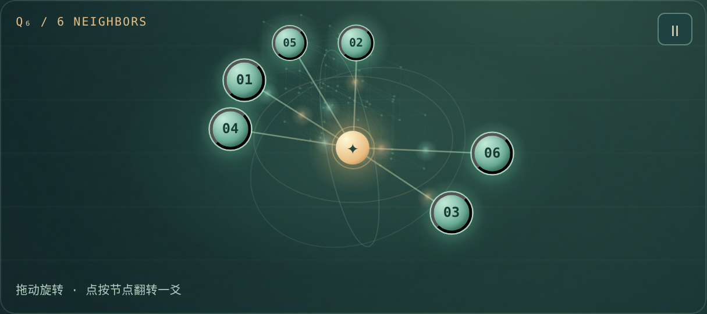
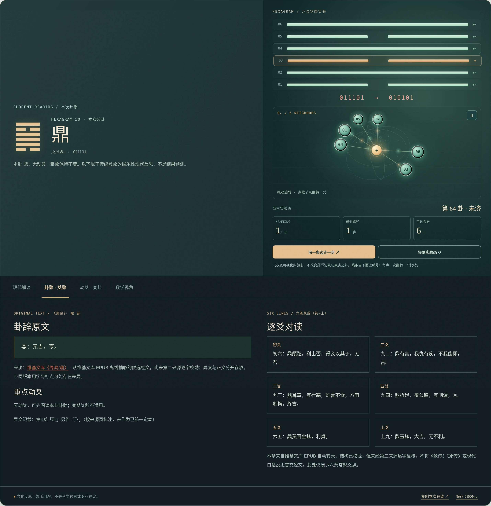

<div align="center">

# YAO LAB · 爻间

**THE LIVING GEOMETRY OF CHANGE**

*Explore the I Ching through interactive geometry, classical texts, and thoughtful AI.*

**64 States &nbsp;·&nbsp; 192 Connections &nbsp;·&nbsp; Six-Bit Geometry &nbsp;·&nbsp; English / 中文**

[**Explore YAO LAB ↗**](https://ylliua1116.github.io/yao-lab/) &nbsp;·&nbsp; [The Idea](#the-idea) &nbsp;·&nbsp; [Explore](#explore) &nbsp;·&nbsp; [中文](#chinese)

</div>




<details>
<summary><strong>Explore the reading interface and all six interactive neighbors · 查看六邻居与原典阅读界面</strong></summary>



<sub>Both previews are native 2× browser captures of the project UI, not illustrations or redrawn mockups. The live site animates continuously; each PNG captures one sharp frame.</sub>

</details>

## The Idea

**What does change look like when every line becomes a coordinate?**

YAO LAB is a browser-based laboratory that brings the *I Ching* into an interactive world of **symbols, probability, and geometry**. Each hexagram is represented by six binary coordinates. Change a line, discover a neighboring state, trace a transformation, and return to the classical text behind it.

Rather than treating the hexagrams as a static collection, YAO LAB invites you to **explore them as a connected system**—one that can be read, manipulated, visualized, and reflected upon.

## Explore

| Experience | Discover |
| :--- | :--- |
| **Cast & Transform** | Cast three coins, enter your own results, and follow the changing lines from an original hexagram to its transformed state. |
| **Living Geometry** | Explore a navigable network of 64 states, six immediate neighbors, animated connections, and interactive geometric projections. |
| **Classical Reading** | Browse 64 hexagram statements, 384 line statements, the two special Qian/Kun statements, and recorded textual variants. |
| **Mathematical Experiments** | Investigate the probabilities of the three-coin method, changing-line patterns, Hamming distance, and state transitions. |
| **AI-Assisted Reflection** | Move from a structured local reading to optional, question-aware AI interpretation. |
| **Bilingual Experience** | Explore the same laboratory in English or Chinese. |

## The Geometry of Change

Each hexagram becomes a point in a six-dimensional binary state space, with its six lines indexed **from bottom to top**:

```text
State space         {0, 1}⁶
Hexagram states     2⁶ = 64
Neighbors per state 6
Connections         64 × 6 / 2 = 192
Distance            Number of differing line positions
```

The result is the **six-dimensional hypercube, Q₆**: a precise mathematical structure behind the laboratory's interactive visualizations. Its six immediate neighbors differ by exactly one line, making every local transformation part of a larger, navigable graph.

## A Living Classical Library

The laboratory includes a browser-accessible transcription of **64 hexagram statements, 384 regular line statements, and two special statements**, together with **48 recorded textual-variant notes**. The corpus is based on a [Wikisource *Zhouyi* EPUB](https://zh.wikisource.org/wiki/周易), with provenance and editorial notes maintained alongside the texts.

[Classical text & provenance](SOURCE_AUDIT.md) &nbsp;·&nbsp; [Text attribution](LICENSE_CLASSICS.md)

## Explore the Source

YAO LAB runs as a static browser application. The classical library and mathematical explorations are bundled with the frontend; AI-assisted readings are an optional extension.

The original software is **source-available under PolyForm Shield 1.0.0**, supporting permitted learning, modification, and reuse while limiting competing products. The YAO LAB name and original mark have separate brand conditions; classical texts retain their own source license. [License and attribution](LICENSE) · [NOTICE](NOTICE) · [Rights map](RIGHTS_MAP.md).

To explore the source locally, clone or download the repository and run:

```bash
python3 -m http.server 8000
```

Open [localhost:8000](http://localhost:8000). No frontend build step is needed.

[Deployment guide](DEPLOYMENT.md) &nbsp;·&nbsp; [Cloudflare Worker](cloudflare-worker/worker.js) &nbsp;·&nbsp; [Text processing tools](scripts/) &nbsp;·&nbsp; [Contribute](https://github.com/ylliua1116/yao-lab/issues)

---

<a id="chinese"></a>

## 中文 · 爻间

**让变化成为可探索的几何。**

爻间 YAO LAB 是一个以《周易》为文化起点的交互式实验网站，将**六十四卦、二进制状态空间、概率实验、动态几何与 AI 辅助思考**连接为一套可亲手操作的体验。

每一卦都对应六个二进制坐标；每次改变一个爻位，便沿着状态网络走向相邻的另一卦。在这里，卦象不只是静态符号，也是一幅能够旋转、操作、追踪与阅读的变化地图。

**[进入爻间在线实验室 ↗](https://ylliua1116.github.io/yao-lab/)**

### 探索什么？

| 体验 | 内容 |
| :--- | :--- |
| **起卦与变化** | 模拟三枚铜钱、手动记录真实投掷，观察本卦、动爻与之卦。 |
| **动态几何** | 探索六十四态网络、六个单爻邻居、流动连线与可交互的几何投影。 |
| **古籍阅读** | 阅读六十四卦卦辞、三百八十四条常规爻辞、乾坤特殊辞及来源异文。 |
| **概率实验** | 观察铜钱模型、动爻分布、汉明距离与状态转换。 |
| **AI 辅助解读** | 在结构化解读之外，按需获得围绕具体问题的文化性分析。 |
| **中英双语** | 在中文与英文界面之间自由切换。 |

### 六十四态的数学之美

从初爻到上爻，将六爻表示为六位二进制向量，便得到 **64 个状态、每个状态 6 个单爻邻居、总计 192 条无向连接**。这正是六维超立方体 **Q₆** 的图结构。网页通过可交互的三维投影，让抽象的六维状态关系变得直观可见。

### 经典文本与现代交互

项目内置来自[维基文库《周易》](https://zh.wikisource.org/wiki/周易) EPUB 的数字转录，经文与现代解读分别呈现，并记录文本来源与异文注记。详细来源、转录过程与审校记录见 [古籍来源说明](SOURCE_AUDIT.md)。

### 源码阅读与复现

网站主要交互在浏览器中运行。**源码采用 PolyForm Shield 1.0.0 受限开放授权**：许可范围内可学习、修改及复用，竞争性产品受到限制；古籍内容另有来源许可。想要研究或在授权范围内二次开发，可以直接阅读源码，也可以在仓库根目录启动本地 HTTP 服务：

```bash
python3 -m http.server 8000
```

随后访问 [localhost:8000](http://localhost:8000)。自行部署及云端 AI 配置参见 [部署文档](DEPLOYMENT.md)；古籍处理工具位于 [`scripts/`](scripts/)。

欢迎通过 [GitHub Issues](https://github.com/ylliua1116/yao-lab/issues) 分享体验、建议与文本修订线索。

---

<div align="center">

**YAO LAB · 爻间**

*Tradition, rendered as a landscape of questions and transformations.*

[Cite this software](CITATION.cff) &nbsp;·&nbsp; [Authorship](AUTHORS.md) &nbsp;·&nbsp; [Brand](BRAND_POLICY.md) &nbsp;·&nbsp; [Source License · PolyForm Shield](LICENSE) &nbsp;·&nbsp; [Text attribution](LICENSE_CLASSICS.md) &nbsp;·&nbsp; [Source notes](SOURCE_AUDIT.md)

© 2026 [Yuli Liu](https://github.com/ylliua1116)

</div>
